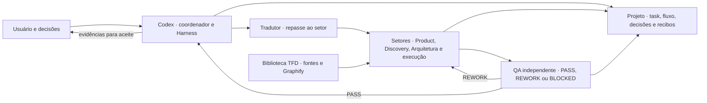

# The Factory Developer (TFD)

O **The Factory Developer** é um plugin para conduzir entregas de software no Codex. O coordenador organiza o trabalho por módulo, encaminha microtarefas a especialistas e reúne os artefatos, testes e revisões que sustentam cada decisão, do briefing à entrega.

**TFD `0.1.6`** · [Revisões publicadas em `office/reviewed-delivery`](https://github.com/guilhermedemorais-dev/TFD/commits/office/reviewed-delivery/) · [Histórico completo de atualizações](docs/CHANGELOG.md)

## Instalação

Copie e cole o prompt abaixo em um agente com acesso ao terminal e à rede da máquina onde o Codex será usado. O agente obtém o TFD direto do repositório oficial.

```text
Instale o The Factory Developer no perfil ativo do Codex. Use o repositório
https://github.com/guilhermedemorais-dev/TFD.git e a branch office/reviewed-delivery.

1. Confirme acesso ao terminal e à rede, sistema operacional, arquitetura,
   perfil do Codex, Git, Codex CLI e Python 3.10+ com venv e pip. Use as
   ferramentas e o perfil do mesmo ambiente quando o Codex rodar no WSL.
2. Clone o repositório com git clone --branch office/reviewed-delivery em
   uma pasta nova fora do projeto em que estou trabalhando. Confira a URL da
   origem, a branch e o commit em relação ao GitHub. Leia docs/GUIA-CODEX.md.
3. Na pasta clonada, use Python com -B para executar scripts/install_tfd.py
   check --ref office/reviewed-delivery. Confira também o catálogo tfd-local.
   Se o perfil não tiver esse catálogo, use install --ref office/reviewed-delivery.
   Para um catálogo Git limpo nesse canal, sem origem local no recibo, use
   update --ref office/reviewed-delivery se o resultado for UPDATE_AVAILABLE
   ou INSTALL_REQUIRED.
   Em instalações locais, personalizadas ou de outra branch, preserve o catálogo.
   Mostre o plano com --source, --base e --dry-run usando uma base confirmada
   e espere meu aceite para aplicar a atualização preservadora.
4. Informe a versão do pacote, a revisão, o estado do plugin e dos agentes,
   os comandos e resultados, e o teste do guia para uma nova sessão do Codex.
   Se faltar algum acesso ou pré-requisito, diga o que falta e indique como
   prosseguir na máquina do Codex. Responda em português do Brasil.
```

**Pelo terminal.** Em um perfil sem catálogo TFD, escolha uma pasta nova fora do seu projeto e rode os comandos. No Linux, use `python3` no lugar de `python`. O instalador requer Git, Codex CLI e Python 3.10+ com `venv` e `pip`.

```powershell
git clone --branch office/reviewed-delivery https://github.com/guilhermedemorais-dev/TFD.git tfd-reviewed
cd tfd-reviewed
python -B scripts/install_tfd.py check --ref office/reviewed-delivery
python -B scripts/install_tfd.py install --ref office/reviewed-delivery
```

O instalador usa `main` como canal padrão em novas instalações. Os comandos acima selecionam `office/reviewed-delivery` explicitamente. O `check` informa `INSTALL_REQUIRED`, `UPDATE_AVAILABLE` ou `UP_TO_DATE`. Para um catálogo Git limpo já nesse canal, use `update --ref office/reviewed-delivery`. Para instalações locais, personalizadas ou de outra branch, confira primeiro a atualização preservadora com `--dry-run`. [Guia de instalação e atualização](docs/GUIA-CODEX.md)

## Primeira entrega

Abra uma **nova sessão do Codex na pasta do projeto**. Para conferir a instalação, peça “Me dá um relatório de onde estamos neste projeto.” O TFD deve usar os registros disponíveis ou apontar o que falta para iniciar. Em seguida, envie um pedido que identifique o módulo, o objetivo e o limite de atuação.

```text
Use o TFD para preparar o módulo de cadastro de clientes. O objetivo é permitir
o cadastro e a busca pelo nome. Importe dados antigos somente se eu aprovar
essa ampliação de escopo. Comece pelas regras do projeto e pela checagem do
ambiente. Faça o briefing e me apresente o PRD para aprovação.
```

Para retomar em outro chat, envie “Retome o módulo de cadastro. Leia o `workflow.json`, a task JSON e as evidências. Mostre o gate atual, o último item verificado e o próximo passo permitido.” Para tratar um `REWORK`, informe qual revisão o QA avaliou e peça a correção dos achados no mesmo módulo.

## Arquitetura em blocos



| Bloco | Responsabilidade e ponto de entrada |
| --- | --- |
| Orquestração | O agente principal coordena com `TFD-harness`. O Tradutor concentra o pedido do usuário no repasse ao setor ativo. O subagente `tfd_harness` consulta status e evidências. [Harness](skills/TFD-harness/SKILL.md) |
| Setores e QA | Cada especialista recebe a microtarefa, os limites e as referências aplicáveis. Um revisor independente avalia a revisão entregue. [Mapa de setores](docs/00-arquitetura.md) |
| Contratos e evidências | O `task.json` é o contrato do módulo. Sua visão Markdown é gerada. O `workflow.json` registra gates, revisões, evidências e decisões. [Tasks por setor](docs/sector-task.md) |
| Conhecimento | O Discovery consulta evidências e decisões do projeto antes de pesquisar novas fontes. O Graphify navega o bundle do TFD. Seu runtime isolado exige configuração à parte em Linux ou WSL 2. [Biblioteca](library/README.md) · [Graphify](library/docs/operations/graphify.md) |
| Execução e medição | O adaptador Codex integra agentes, seleção opcional de modelos autorizados, retomada por item e recibos de uso. A medição separa entrada nova, cache, saída e ocupação da janela. [Execução de microtarefas](skills/TFD-harness/references/execution.md) · [Recibos e compactação](hosts/codex/README.md#token-receipts) |

## Da abertura à entrega

| Etapa | O que pedir e o que conferir |
| --- | --- |
| **G0 · Constituição** | Defina o objetivo, as regras e as restrições do projeto. Confira o escopo e aprove a constituição antes do preparo do ambiente. |
| **G0.5 · Ambiente** | Peça ao DevOps para verificar repositório, ferramentas, dependências, CI e acessos aplicáveis. Para projetos no GitHub, aprove o contrato que identifica contas, destinos, responsáveis e permissões por operação. Se um administrador precisar agir, o relatório indica a operação bloqueada e como verificar o resultado. [Contrato de governança](skills/TFD-devops/references/project-governance.md) |
| **G1 · Briefing e PRD** | Responda às perguntas de Product sobre público, comportamento, escopo e critérios. Aprove o PRD antes da preparação técnica. |
| **G2 · Discovery** | Peça pesquisa para as lacunas do PRD. Confira o estado atual, os achados, as fontes e as perguntas ainda abertas. |
| **G3 · Revisão de PRD e Discovery** | Peça a revisão independente do PRD e dos achados pelo `qa_spec`. Confira as lacunas que afetam as próximas decisões e os achados devolvidos para correção. |
| **G4 · Arquitetura e contratos** | Peça decisões de arquitetura, interfaces e contratos verificáveis. Confira a ligação com o PRD e o parecer de `qa_spec`. |
| **G5 · Planejamento** | Confira o plano de fases, as dependências e a faixa de esforço antes de pedir a spec da primeira fase. |
| **G6 · Spec por fase** | Peça a spec, o Discovery correspondente, a task JSON e a visão Markdown. Após o `PASS` do QA de spec para essa revisão, aprove a task e a spec da fase. |
| **G7 · Implementação por fase** | Com G6 aprovado, peça a implementação da fase. O responsável segue as dependências, executa e verifica cada item da microtarefa. O QA valida a entrega e devolve os achados para correção. Confira o resultado e aprove a revisão após os testes e o `PASS` aplicável. |
| **G8-review · Revisão local** | Peça o pacote de revisão com a revisão exata, comandos e resultados. Valide o comportamento no ambiente local e registre seu aceite. |
| **G8 · Documentação** | Peça a documentação técnica e a ajuda ao usuário da revisão aceita. Confira os fluxos documentados e os perfis de acesso. No perfil de quadro, o conteúdo técnico é restrito a administradores e os tutoriais ficam disponíveis também aos usuários regulares. Registre o aceite final da documentação. |
| **DevOps e entrega** | Se o projeto adotou o perfil de quadro, peça o candidato com implementação e documentação aceitas, evidências de staging autorizado, segurança e rollback. Confira o artefato e o ambiente de destino. Autorize merge e deploy separadamente. Depois do deploy, confira os testes no ambiente autorizado antes de marcar `Done`. |

Por padrão, cada gate exige aceite humano após as revisões aplicáveis. Com `reviewed_task` explicitamente autorizado e registrado, o coordenador pode concluir G2–G5 depois das verificações aplicáveis. Um `PASS` vale para a revisão registrada. `REWORK` volta ao responsável, seguido de nova revisão independente. `BLOCKED` pede que se resolva a causa antes de seguir. No perfil opcional de GitHub Projects, a issue acompanha a fase e exibe as etiquetas `QA em andamento` ou `Em ajustes`, conforme o trabalho observado e as permissões disponíveis. [Gates e aprovações](skills/TFD-harness/references/gates.md) · [Quadro de entrega](docs/delivery-board.md)

No GitHub, o contrato separa a permissão técnica em cada recurso da autorização para agir. O responsável pelo quadro segue o contrato aceito e só move o item para revisão humana após todos os revisores aplicáveis darem `PASS` para a revisão atual, com evidências na mesma Issue. [Contrato de governança](skills/TFD-devops/references/project-governance.md)

Ao aprovar, cite a fase e a revisão apresentada. Por exemplo, “Aprovo a spec e a task da fase Cadastro na revisão apresentada `r2`. Registre meu aceite no `workflow.json`.” Se pedir ajuste, descreva o comportamento esperado na mesma tarefa e peça nova verificação.

### Conferir os artefatos pelo terminal

Estes comandos podem ser executados na raiz do repositório TFD com os exemplos incluídos. O validador confere o contrato da task. A consulta do fluxo inicial deve indicar que G0 aguarda a constituição.

```powershell
python -B scripts/validate_task.py examples/task.example.json
python -B scripts/resume_task.py examples/workflow.example.json --project-root .
```

Para tarefas reais, aponte os comandos para os registros do projeto e informe a raiz desse projeto ao consultar o fluxo. A revisão recebe a task JSON e sua visão Markdown. Cada microtarefa identifica dependências, `@responsável`, `@validador`, caminhos permitidos, itens do checklist e resultado esperado. [Validação, geração e recorte por setor](docs/sector-task.md)

## Atualizações recentes

O manifesto define a versão do pacote. O commit identifica a revisão exata publicada em cada canal. O histórico registra os dois dados e mantém as mudanças em revisão em uma seção própria. [Histórico completo de atualizações](docs/CHANGELOG.md)

| Data | Commit | Motivo | Correção ou melhoria |
| --- | --- | --- | --- |
| 2026-11-11 | [`10eb0f2`](https://github.com/guilhermedemorais-dev/TFD/commit/10eb0f28818165381ae1196da9dcb46f57947ffd) | Retomar entregas e limitar o contexto enviado a cada agente. | Adiciona checkpoints, verificação de caminhos, roteamento de modelos e medição de compactação. Documenta o quadro e permite consultar a branch de revisão no instalador. |
| 2026-11-11 | [`e138636`](https://github.com/guilhermedemorais-dev/TFD/commit/e1386369b6f9d529d7850b0d27a6c41045c545fa) | Esclarecer qual contrato rege a task. | Distingue o schema nativo do TFD dos exemplos de contratos da biblioteca. |
| 2026-11-10 | [`91e92f4`](https://github.com/guilhermedemorais-dev/TFD/commit/91e92f4efb310bcf3a83094004ef40601359a562) | Reproduzir a suíte no Windows. | Corrige importações entre testes e documenta o preparo do `pytest`. |
| 2026-11-10 | [`aed39a8`](https://github.com/guilhermedemorais-dev/TFD/commit/aed39a843c74851f658e1e85a63a65b2946dadba) | Explicitar quem coordena e preservar personalizações instaladas. | Mostra coordenação e limites na task e adiciona atualização local com simulação e backup. |
| 2026-11-09 | [`d134c38`](https://github.com/guilhermedemorais-dev/TFD/commit/d134c3887f79937d413172fedfe418ecb97024ed) | Preparar tasks revisadas e fundamentar decisões técnicas. | Introduz preparação autorizada, validação do parecer de spec e pesquisa técnica por lacuna. |
| 2026-11-09 | [`38197b7`](https://github.com/guilhermedemorais-dev/TFD/commit/38197b7730c9925207f1aea01c615e04daf23209) | Encontrar referências do TFD com contexto limitado. | Integra Graphify ao bundle com runtime isolado e fallback de busca. |
| 2026-11-09 | [`e3c442f`](https://github.com/guilhermedemorais-dev/TFD/commit/e3c442fbb30595bc4629e8b3ac5eaac8eeddeccd) | Tornar a instalação reproduzível. | Adiciona instalação, consulta de revisão e atualização pelo Codex. |

Veja a motivação, o efeito e as verificações de cada atualização no [histórico de mudanças](docs/CHANGELOG.md).

## Documentação

| Quero… | Documento |
| --- | --- |
| Instalar, atualizar ou recuperar um perfil | [Guia do Codex](docs/GUIA-CODEX.md) |
| Entender arquitetura, setores e decisões | [Arquitetura do TFD](docs/00-arquitetura.md) |
| Escrever ou revisar uma task | [Tasks por setor](docs/sector-task.md) · [Contrato dos gates](skills/TFD-harness/references/gates.md) |
| Preparar repositório, CI e quadro | [Prontidão do GitHub](skills/TFD-devops/references/github-readiness.md) · [Quadro de entrega](docs/delivery-board.md) |
| Consultar evidências e limites de verificação | [Estado do projeto](docs/ESTADO.md) · [Preparação revisada](docs/reviewed-delivery/README.md) |
| Manter skills e referências | [Padrão de skills](skills/TFD-maintenance/references/skill-standard.md) · [Biblioteca](library/README.md) |

### Testes do plugin

Na raiz do repositório Git, execute a suíte em um ambiente virtual Python. Use `python3` no Linux se esse for o comando do seu ambiente. `pytest` é dependência da suíte.

```powershell
python -m pip install -r requirements.txt pytest
python -B -m pytest -q
```

## Referências técnicas

O TFD usa o Graphify no próprio bundle, instruções concisas nas skills e o Tradutor nos repasses. Estudos como LLMLingua, GraphRAG, RepoGraph e GraphCoder fundamentam decisões e pesquisas. A arquitetura detalha o vínculo entre cada fonte, a decisão e o que está implementado. [Fundamentos e fontes](docs/00-arquitetura.md#fundamentos-e-fontes)

Para uma lacuna de engenharia, o Discovery consulta capítulos relevantes do guia de Matthew Kerns na fonte e confirma as decisões importantes em referências primárias. O projeto guarda apenas os achados aplicáveis e sua proveniência. [Guia externo](https://github.com/MatthewKerns/software-development-best-practices-guide)
