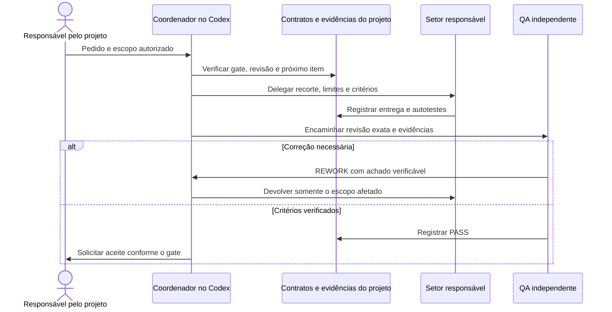

> Contexto TFD · 2624 palavras · 5122 tokens (o200k_base)

# Arquitetura — The Factory Developer (TFD)

O TFD coordena PRD, Discovery, arquitetura, implementação e entrega com
evidências rastreáveis e aprovação humana conforme a política explícita dos gates.
O [manifesto do plugin](../.codex-plugin/plugin.json) define a versão do pacote.
O [histórico de mudanças](CHANGELOG.md) identifica as revisões e explica sua
motivação, correção e impacto.

## 1. Nome e escopo

- Plugin `the-factory-developer` (TFD), com skills e agentes identificados pelo
  prefixo TFD.
- **Núcleo independente do host.** Os contratos e validadores Python são
  locais. O adaptador disponível registra skills e subagentes no Codex.
  [Adaptador Codex](../hosts/codex/README.md)
- O núcleo fornece contratos, validação e regras de transição. O coordenador
  interpreta os resultados, delega trabalho e registra a evidência do host.

### Blocos e fronteiras

| Bloco | Responsabilidade e fronteira | Onde conferir |
| --- | --- | --- |
| Host Codex | Carrega as skills, disponibiliza subagentes e aplica as permissões da sessão. O instalador prepara o perfil e registra a origem e a revisão. | [Guia do Codex](GUIA-CODEX.md) · [Adaptador](../hosts/codex/README.md) |
| Coordenação | O agente principal usa a skill Harness para ler o estado, verificar o gate e delegar ao setor. O Tradutor preserva o pedido no repasse. O subagente `tfd_harness` consulta o estado. | [Harness](../skills/TFD-harness/SKILL.md) · [Tradutor](../skills/tfd-translator/SKILL.md) |
| Execução e QA | Especialistas produzem artefatos. Revisores independentes avaliam a revisão submetida. A pessoa responsável registra o aceite nos gates previstos. | [Setores](#3-setores) · [Contrato dos gates](../skills/TFD-harness/references/gates.md) |
| Contratos e retomada | A Task vincula requisitos a microtarefas, critérios e testes. O log e as evidências do módulo registram progresso, revisões e aprovações. Os checkpoints registram itens verificados. | [Task](../schemas/task.json) · [Pipeline](../scripts/pipeline.py) · [Retomada](../scripts/resume_task.py) |
| Conhecimento | O projeto guarda seus próprios achados, decisões e restrições. A biblioteca do TFD fornece referências reutilizáveis. Graphify localiza fontes do bundle e o Discovery abre as fontes canônicas. | [Discovery](../skills/TFD-discovery/SKILL.md) · [Graphify](../integrations/graphify/README.md) |
| Recursos de execução | O roteador opcional seleciona perfis autorizados para a tarefa. O medidor lê recibos do Codex e distingue custo de contexto. | [Roteador](../scripts/model_router.py) · [Execução por setor](../skills/TFD-harness/references/execution.md) · [Medidor](../scripts/token_usage.py) |
| Operação | DevOps verifica o ambiente e registra a governança GitHub do projeto em G0.5. O contrato aceito identifica recursos, responsáveis e autorizações. O perfil opcional de quadro reflete as decisões da tarefa. | [Prontidão GitHub](../skills/TFD-devops/references/github-readiness.md) · [Governança por projeto](../skills/TFD-devops/references/project-governance.md) · [Quadro](delivery-board.md) |



## 2. Princípios

1. Plugin = método; projeto = conhecimento.
2. Setorização é economia de contexto: o harness lê o todo; o setor lê a fatia.
3. Evidência vence prosa.
4. Regra determinística vira código; julgamento vira uma página.
5. Quem executa não aprova o próprio trabalho.
6. Humano aprova escopo, PRD, task, etapas implementadas, prazo, merge e deploy. Preparação técnica só pode ser consolidada por autorização explícita.
7. Complementar é plugável, versionado e autorizado antes de instalar.

## 3. Setores

| # | Setor | Responsabilidade | Não faz |
|---|---|---|---|
| 1 | `product` | briefing, PRD, escopo, prioridade, perguntas ao cliente | arquitetura e código |
| 2 | `discovery` | fontes, as-is, engenharia reversa assistida, riscos, lacunas | decidir arquitetura |
| 3 | `architecture` | arquitetura, contratos, ADRs, plano de fases e autoria da spec | implementar ou aprovar a própria spec |
| 4 | `database` | modelo, migração, integridade, rollback | API e UI |
| 5 | `backend` | código, contrato de API, teste do próprio código | aprovar a si mesmo |
| 6 | `frontend` | código, estados, acessibilidade, teste do próprio código | aprovar a si mesmo |
| 7 | `ui_ux` | design system do projeto, guia vivo, revisão visual | codar produção |
| 8 | `qa_spec` | revisa PRD, discovery, contratos e spec antes de construir: ambiguidade, contradição, lacuna, testabilidade, rastreabilidade | implementar ou reescrever o artefato pelo autor |
| 9 | `qa_backend` | validação independente de API, dados e regra | corrigir pelo autor |
| 10 | `qa_ui` | validação independente de tela, fluxo e acessibilidade | corrigir pelo autor |
| 11 | `security` | ameaça, authn/authz, segredo, dependência, dado sensível | aprovar sozinho |
| 12 | `devops` | ambiente, repositório, CI/CD, observabilidade, rollback | codar produto |
| 13 | `documentation` | arquitetura da documentação, guia técnico e do usuário, HTML | inventar comportamento |

Fora do pipeline de produção:

- `harness`: orquestra, reconcilia evidência, não escreve produto.
- `translator` (Tradutor): comprime e traduz o pedido para o setor ativo, com resposta ao usuário em português do Brasil. Atua antes da delegação.
- `oficina`: plugin separado de manutenção e evolução do próprio harness. Só
  atua sob pedido do usuário ou por incidente detectado. Nunca durante task de
  cliente.

**Regra de QA:** a especificação é revisada pelo `qa_spec` **antes** da
implementação; backend e frontend testam o que escrevem; depois `qa_backend` e
`qa_ui` validam de forma independente, na revisão atual. Quem escreveu não pode
atestar o próprio PASS, seja spec, código ou documentação.

## 4. Pipeline

```
G0   Constituição do projeto            princípios e restrições
G0.5 Preparação do ambiente (devops)    repo, deps, MCP, auth, versões, SO
G1   Briefing + PRD (product)           escopo, não-escopo, referências
G2   Discovery (discovery)              fontes, as-is, riscos, lacunas
G3   Revisão inicial (qa_spec)          PRD e Discovery, com retorno à pesquisa se necessário
G4   Arquitetura e contratos            completo (seção 5)
G5   Plano de fases + estimativa        módulos, fases, prazo, aprovação
G6   Por fase: spec + Discovery → qa_spec → rework de pesquisa/spec → nova revisão
       → PASS do QA → aprovação humana da task → produção
G7   Por etapa da task:
       build + autoteste (backend/frontend)
       → QA independente (qa_backend/qa_ui)
       → segurança/UX/devops quando o gatilho aplicar
       → rework até cumprir a spec (no fim da etapa)
       → aprovação humana da etapa
G8-review  Pacote de revisão + verificação local → aceite humano
G8         Documentação técnica e de usuário → aceite humano
```

Gates que falham param a transição afetada. Registre o comando e a evidência de
prontidão que falta quando houver bloqueio. No perfil de quadro por fases, após G8,
DevOps prepara e verifica o candidato para revisão humana. Merge e deploy exigem
autorizações próprias. [Fluxo de entrega e publicação](delivery-board.md)

O padrão continua manual. Com `preparation.mode=reviewed_task` e registro da
autorização humana, G2-G5 permitem `complete` por coordenador independente,
depois do QA aplicável. G1 mantém o briefing interativo; G6 exige task apontando
para a mesma spec do PASS estruturado e aprovação humana. G7 e G8 mantêm suas
aprovações. [Contrato executável e limites](../skills/TFD-harness/references/gates.md)

Instruções curtas por setor orientam decisões e testes. Teoria fica consultável
na biblioteca, com Graphify como navegação e leitura da fonte canônica. Lacunas
técnicas materiais podem abrir pesquisa em qualquer etapa, além dos 80 conceitos
ou do PDF, incluindo guias externos avaliados criticamente. Reutilizam-se fontes
compatíveis; decisões, versões, limites e evidências ficam no projeto. Referências
obrigatórias nunca são eliminadas para reduzir contexto.

## 5. G4 — Arquitetura e contratos (completo)

Nenhum item é opcional sem justificativa registrada.

1. **Drivers e atributos de qualidade**: desempenho, disponibilidade, segurança,
   custo, operabilidade, escalabilidade, compliance. Cada um com métrica.
2. **Contexto e fronteiras**: atores, sistemas externos, o que é nosso e o que não é.
3. **Visões C4**: contexto, containers, componentes; uma sequência de runtime para
   cada fluxo crítico.
4. **Dados**: modelo conceitual e físico, dono de cada entidade, ciclo de vida,
   retenção, migração, rollback, integridade e concorrência.
5. **Contratos de integração**: OpenAPI para HTTP, AsyncAPI/eventos, webhooks,
   idempotência, versionamento, erros, autenticação.
6. **Segurança**: fronteiras de confiança, authn/authz, sessão, segredo, upload,
   dado pessoal, ameaças (STRIDE) e mitigação.
7. **Implantação**: ambientes, topologia, configuração, CI/CD, rollback, backup.
8. **Observabilidade**: logs, métricas, traces, SLO, alerta, runbook.
9. **ADRs**: contexto, alternativas, decisão, consequência, critério de reversão.
10. **NFRs verificáveis** e *fitness functions* (teste automatizado da propriedade).
11. **Riscos e premissas** com impacto e mitigação.
12. **Rastreabilidade**: REQ → decisão → contrato → teste.

## 6. Estrutura da task por módulo

Campos obrigatórios:

- `goal`, `scope`, `out_of_scope`, `allowed_paths`, `protected_paths`
- `requirements` (REQ) com fonte e prioridade
- `business_rules`
- `references` com path e finalidade
- `microtasks` com `owner`, `checklist`, `deliverables`, `completion_condition`,
  `validator`
- `acceptance_criteria` (AC) com `validation` apontando para `TEST`
- `required_tests` com comando e esperado
- `stop_conditions`
- `gates` do módulo
- `estimate` (seção 7)

Regra de ouro: **o que fazer e o que não fazer**. A execução pesquisa fatos técnicos
dentro do escopo autorizado. Decisão de negócio ausente, mudança material de escopo
ou conflito de autoridade retorna ao usuário; não se inventa um requisito.

## 7. Prazo e estimativa

O cliente pergunta prazo. A resposta honesta tem três níveis:

| Momento | Precisão | O que dá para dizer |
|---|---|---|
| G1 (PRD) | ordem de grandeza | faixa por módulo, com premissas |
| G5 (plano de fases) | estimativa de três pontos | faixa por fase, confiança e data-alvo quando houver base |
| Após fases medidas | calibração com dados observados | faixa revista com ritmo e causas de variação por setor |

Em G5, use as microtarefas para estimar cada fase em três pontos: otimista,
provável e pessimista. Registre premissas, confiança e base de comparação.
Ao fechar a fase, registre o realizado e use esse histórico para revisar a faixa.
[Schema da estimativa](../schemas/estimate.json) · [Validador](../scripts/validate_estimate.py)

## 8. Rework

O autor entrega e executa autotestes. O QA registra `PASS`, `REWORK` ou
`BLOCKED` na revisão atual. Em `REWORK`, o coordenador devolve os achados ao
responsável, que reconcilia efeitos já produzidos e corrige o escopo afetado.
A nova revisão passa por QA. Evidências de microtarefas dependentes são
revalidadas quando a correção as invalida. Depois do PASS aplicável, a etapa
segue para o aceite humano previsto no gate.

O contrato admite até três submissões de correção por gate. Outro `REWORK`
registra `BLOCKED`. A execução por item aplica o limite à rodada da microtarefa
e mantém seus checkpoints no projeto. [Execução e retomada](../skills/TFD-harness/references/execution.md)

## 9. Evidência

O Discovery registra `sources.json`, `evidence.json` e `findings.md` com IDs
estáveis, origem, revisão, seção e limites. `OBSERVED` identifica fato verificado,
`INFERRED` explicita a dedução e `UNKNOWN` registra o que falta confirmar. A spec
vincula as conclusões às evidências. Testes e verificações registram os comandos,
resultados e códigos de saída observados para a revisão entregue.
[Formato da evidência de Discovery](../skills/TFD-discovery/references/evidence-format.md)

## 10. Plugins complementares

O setor pode consultar procedimentos no [índice da biblioteca](../library/indexes/resources.json).
Integrações opcionais, como engenharia reversa assistida, dependem de instalação,
capacidade do host e autorização para o alvo. O Discovery registra a fonte, o
escopo e os limites das observações antes de usá-las na especificação.

## 11. Hospedeiros (hosts) e sistemas operacionais

Os contratos locais usam Python e arquivos do projeto. O adaptador entregue neste
repositório é o Codex, com procedimento para Windows e Linux. No WSL, instale no
lado em que o Codex roda. O instalador usa o perfil ativo e registra a revisão.
Graphify usa um runtime isolado quando habilitado e possui fallback de consulta.
Outros hosts exigem integração e validação próprias. [Instalação suportada](GUIA-CODEX.md)

## 12. Plugin de manutenção — `oficina` (separado)

A manutenção não mora no TFD. É plugin próprio, instalado à parte, e a skill
global só o chama quando há motivo.

### Gatilhos

1. **Pedido do usuário**: "corrige a skill de QA", "audita os setores".
2. **Incidente detectado pelo harness**:
   - o mesmo gate reprovou 2 vezes pelo mesmo motivo;
   - rework passou de 2 ciclos na mesma etapa;
   - skill referenciada não existe ou mudou de hash (drift);
   - `BLOCKED` repetido por falta da mesma ferramenta;
   - spec aprovada gerou implementação que falhou no aceite.

### Ciclo

```
observar → registrar incidente → diagnosticar causa raiz → propor
→ autorização do usuário → corrigir → testar → registrar resultado
```

Os incidentes de manutenção do plugin podem ser registrados em `docs/office/incidents/`:

```json
{
  "id": "INC-014",
  "when": "2026-11-05T00:10:00Z",
  "task": "DEMO-012",
  "symptom": "qa_spec reprovou 2x por AC sem teste",
  "root_cause": "skill spec não exige AC → TEST",
  "fix": "regra + checklist no skill spec",
  "status": "proposed|approved|fixed|verified",
  "evidence": "receipts/DEMO-012.json"
}
```

### Regras

- **Sempre reporta ao usuário**: sintoma, causa raiz, mudança proposta, risco e
  evidência. Nunca altera em silêncio.
- Modos **AUDIT** (só lê e propõe) e **CHANGE** (só com autorização explícita).
- Branch própria, sem merge automático, teste antes e depois.
- Fora de task de cliente: nunca autoaltera durante execução de projeto.
- Método: Skill Creator V2 verificada (versão e hash) e [padrão de skills do TFD](../skills/TFD-maintenance/references/skill-standard.md).
  O padrão cobre orçamento de tokens, versionamento e teste de roteamento.

### O que ele melhora

Para incidentes, documente a causa e repita a verificação após a correção.
Para manutenção solicitada, registre motivação, mudança e impacto no
[histórico](CHANGELOG.md).

## 13. O que o TFD não faz

- Não clona produto de terceiro.
- Não instala ferramenta sem autorização.
- Não aprova o próprio trabalho.
- Não guarda conhecimento de cliente dentro do plugin.
- Não promete prazo sem faixa e premissa.
- Não fica presa a um host nem a um modelo.

## Fundamentos e fontes

As linhas abaixo ligam referências aos usos documentados no TFD. A última
coluna aponta para o contrato, implementação ou limite da aplicação.

| Referência técnica | Aplicação no TFD | Contrato e alcance |
| --- | --- | --- |
| [Modelo C4](https://c4model.com/) · [ADRs, Michael Nygard](https://cognitect.com/blog/2011/11/15/documenting-architecture-decisions) | Descrever contexto, fronteiras e componentes em G4. Registrar alternativas, decisão e consequências no projeto. | [Skill de Arquitetura](../skills/TFD-architecture/SKILL.md) |
| [OpenAPI Initiative](https://spec.openapis.org/oas/latest.html) · [AsyncAPI Initiative](https://www.asyncapi.com/docs/reference/specification/latest) · [STRIDE, Microsoft](https://learn.microsoft.com/en-us/azure/security/develop/threat-modeling-tool-threats) | Especificar integrações HTTP, eventos e ameaças quando aplicável. Relacionar os contratos a critérios e testes. | [Spec por fase](../skills/TFD-architecture/references/phase-spec.md) · [Segurança](../skills/TFD-security/SKILL.md) |
| [JSON Schema 2020-12](https://json-schema.org/draft/2020-12) | Descrever o contrato da Task e da estimativa. O validador local combina checagens estruturais com regras de rastreabilidade, dependências e autoria. | [Schema](../schemas/task.json) · [Validador](../scripts/validate_task.py) |
| [Subagentes do Codex](https://learn.chatgpt.com/docs/agent-configuration/subagents) · [App Server](https://learn.chatgpt.com/docs/app-server#models) · [Configuração](https://learn.chatgpt.com/docs/config-file/config-reference) | Delegar por função, confrontar modelo e esforço efetivos com o solicitado e observar eventos de compactação do host. | [Adaptador Codex](../hosts/codex/README.md) · [Execução](../skills/TFD-harness/references/execution.md) |
| [LLMLingua](https://aclanthology.org/2023.emnlp-main.825/) · [LLMLingua-2](https://aclanthology.org/2024.findings-acl.57/) | Estudos de compressão de contexto consultados como referência. A abordagem implementada combina instruções concisas, recorte por microtarefa e repasse pelo Tradutor. | [Padrão de skills](../skills/TFD-maintenance/references/skill-standard.md) · [Recibos de tokens](../hosts/codex/README.md#token-receipts) |
| [GraphRAG](https://www.microsoft.com/en-us/research/publication/from-local-to-global-a-graph-rag-approach-to-query-focused-summarization/) · [RepoGraph](https://proceedings.iclr.cc/paper_files/paper/2025/hash/4a4a3c197deac042461c677219efd36c-Abstract-Conference.html) · [GraphCoder](https://arxiv.org/abs/2406.07003) · [Graphify](https://github.com/Graphify-Labs/graphify) | Os artigos são referências de pesquisa sobre recuperação por relações. A implementação usa Graphify no bundle TFD e consulta lexical como fallback. A avaliação de grafos sobre projetos é pesquisa futura. | [Versão fixada](../integrations/graphify/pin.json) · [Operação](../library/docs/operations/graphify.md) · [Verificação local](receipts/2026-11-09-graphify.md) |
| [Context7 MCP](https://context7.com/docs/resources/all-clients) | Consulta opcional de documentação técnica quando o host disponibiliza a integração. O Discovery registra a origem e confirma os fatos relevantes na documentação da tecnologia. | [Skill de Discovery](../skills/TFD-discovery/SKILL.md) |
| [Guia de Matthew Kerns](https://github.com/MatthewKerns/software-development-best-practices-guide) | Referência externa para lacunas de engenharia. O Discovery consulta capítulos na origem, verifica pontos decisivos em fontes primárias e registra somente achados aplicáveis no projeto. | [Procedimento de decisão técnica](../library/architecture/technical-decision-procedure.md) · [Avaliação registrada](reviewed-delivery/verification.md) |

As regras de aceite humano, revisão independente e avanço por gate são decisões
do TFD. A lógica e os limites dessas decisões ficam no [contrato dos gates](../skills/TFD-harness/references/gates.md).
Para consultar a origem e a licença de uma referência distribuída com a
biblioteca, abra o campo `provenance` do [índice de recursos](../library/indexes/resources.json).
