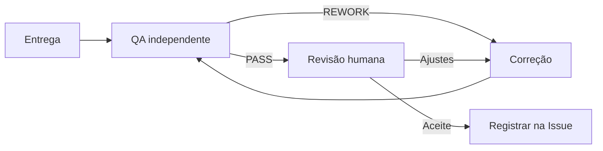

<h1>DEMO-001 · Normalizar nome no cadastro de pessoas</h1>

<strong>Revisão</strong> · r1 · draft

<strong>JSON canônico</strong> · task.example.json

<strong>SHA-256 do JSON</strong> · d1704f84e3e7ede63511d8342aacd7bc0dd7b6cfcf5027f92ab1e1f19179e327

Checklist para aprovar a Task

Registre o aceite ou os ajustes na Issue vinculada e identifique a revisão.

- [ ] Conferi a revisão da Task, da spec e do Discovery.
- [ ] Conferi o QA independente e as evidências aplicáveis a esta revisão.
- [ ] Revisei as microtarefas, os responsáveis, as dependências e os entregáveis.
- [ ] Conferi os critérios de aceite, as regras de negócio e os testes previstos.
- [ ] Conferi os caminhos permitidos, as restrições e as condições de parada.
- [ ] Identifiquei as pendências que afetam meu aceite.

Pareceres e evidências da revisão

<strong>QA registrado no workflow</strong> · Nenhum registrado.

Escopo, restrições e fases

<strong>Objetivo</strong> · Aceitar nome com acento, caixa variada e espaço duplicado sem quebrar a busca do cadastro.

<strong>Complexidade</strong> · normal

<strong>Escopo</strong>
<ul><li>normalização de nome no cadastro de pessoas</li></ul>

<strong>Fora do escopo</strong>
<ul><li>busca global</li><li>migração de dados existentes</li></ul>

<strong>Caminhos permitidos na Task</strong>
<ul><li>src/cadastro/**</li><li>tests/test_cadastro.py</li></ul>

<strong>Caminhos protegidos</strong>
<ul><li>migrations/**</li><li>.github/**</li></ul>

<strong>Condições de parada</strong>
<ul><li>escopo cresceu além de src/cadastro</li><li>contrato conflita com o comportamento atual</li><li>teste exige banco não disponível</li></ul>

<strong>Gates</strong>
<ul><li>implementation · testes verdes e diff dentro de allowed_paths</li><li>review · qa_backend valida independente</li><li>merge · aprovação humana no PR</li></ul>

<strong>Estimativa</strong> · 2 / 4 / 8 h (otimista / provável / pessimista) · low · sem histórico medido deste módulo; faixa por analogia

Regras, critérios, testes e referências técnicas

<strong>Requisitos</strong>
<ul><li>REQ-01 · Nome com acento é normalizado para forma comparável. · MUST · docs/prd/cadastro.md#nome</li><li>REQ-02 · Nome vazio ou só com espaços retorna erro de validação. · MUST · docs/prd/cadastro.md#validacao</li></ul>

<strong>Regras de negócio</strong>
<ul><li>RULE-01 · O nome original é preservado para exibição; a forma normalizada serve à busca. · docs/prd/cadastro.md#regras</li></ul>

<strong>Critérios de aceite</strong>
<ul><li>AC-01 · Nome &#x27;  João   da  Silva &#x27; é aceito e buscável como &#x27;joao da silva&#x27;. · REQ-01 · TEST-01 · MT-01, MT-02</li><li>AC-02 · Nome vazio retorna erro de validação, não grava registro. · REQ-02 · TEST-02 · MT-01, MT-02</li></ul>

<strong>TEST-01</strong> · unit

<strong>Comando ou procedimento</strong> · python -m unittest tests.test_cadastro -q

<strong>Resultado esperado</strong> · exit 0 com os casos de normalização

<strong>TEST-02</strong> · unit

<strong>Comando ou procedimento</strong> · python -m unittest tests.test_cadastro -q

<strong>Resultado esperado</strong> · exit 0 com o caso de nome vazio

<h3>Referências técnicas</h3><ul><li>REF-01 · docs/specs/cadastro/spec.md · Contrato de normalização e casos de borda aprovados.</li></ul>

Microtarefas

MT-01 · Implementar normalização e validação

<strong>Decisão humana · marque uma opção</strong> · 

- [ ] Aprovado
- [ ] Reprovado

<strong>Responsável e validador independente</strong> · @TFD-backend · @TFD-qa_backend

<strong>Depende de</strong> · livre

<strong>Caminhos permitidos</strong>
<ul><li>src/cadastro/**</li></ul>

<strong>Não pode</strong> · Editar fora da lista da microtarefa ou em caminhos protegidos, ampliar o escopo ou contornar gates. Consulte Escopo, restrições e fases.

<strong>Checklist de execução</strong> · 

- [ ] escrever teste que falha sem a normalização
- [ ] implementar a menor mudança que passa
- [ ] rodar o teste de contrato

<strong>Entregáveis</strong>
<ul><li>src/cadastro/normalize.py</li></ul>

<strong>Concluído quando</strong> · Teste de contrato verde e nome original preservado

<strong>Critérios, testes e requisitos vinculados</strong>
<ul><li>AC-01 · TEST-01 · REQ-01</li><li>AC-02 · TEST-02 · REQ-02</li></ul>

<strong>Referências da microtarefa</strong> · Consulte as referências da Task.

<strong>Checkpoint de execução</strong> · Sem registro nesta visão.

<strong>QA independente</strong> · Sem parecer de execução nesta visão.

MT-02 · Cobrir casos de borda no teste

<strong>Decisão humana · marque uma opção</strong> · 

- [ ] Aprovado
- [ ] Reprovado

<strong>Responsável e validador independente</strong> · @TFD-backend · @TFD-qa_backend

<strong>Depende de</strong> · MT-01

<strong>Caminhos permitidos</strong>
<ul><li>tests/test_cadastro.py</li></ul>

<strong>Não pode</strong> · Editar fora da lista da microtarefa ou em caminhos protegidos, ampliar o escopo ou contornar gates. Consulte Escopo, restrições e fases.

<strong>Checklist de execução</strong> · 

- [ ] cobrir acento, caixa e espaço duplicado
- [ ] cobrir vazio e só espaços

<strong>Entregáveis</strong>
<ul><li>tests/test_cadastro.py</li></ul>

<strong>Concluído quando</strong> · Todos os casos de borda cobertos e verdes

<strong>Critérios, testes e requisitos vinculados</strong>
<ul><li>AC-01 · TEST-01 · REQ-01</li><li>AC-02 · TEST-02 · REQ-02</li></ul>

<strong>Referências da microtarefa</strong> · Consulte as referências da Task.

<strong>Checkpoint de execução</strong> · Sem registro nesta visão.

<strong>QA independente</strong> · Sem parecer de execução nesta visão.

